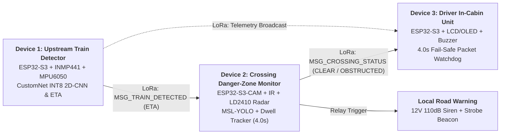

# Decentralized Edge-Interlocking: A Hybrid Acoustic-Vision Neural Pipeline for Predictive Train Detection and Trapped-Vehicle Avoidance at Unprotected Crossings

**Group 42 | Final-Year Software Engineering Project**  
**Academic Year:** 2026 | **Focus Context:** Sri Lanka Railways Unprotected Rural Crossings

An off-grid, solar-powered, 3-node decentralized Edge-AI safety system engineered for unprotected railway level crossings. The system replaces centralized, high-cost track-circuit cabling with localized edge machine learning on Espressif ESP32-S3 microcontrollers and ad-hoc point-to-point Semtech SX1278 LoRa communication at 433 MHz.

---

## Table of Contents
- [System Architecture](#system-architecture)
- [3-Node Edge Hardware Responsibilities](#3-node-edge-hardware-responsibilities)
- [Edge Machine Learning Pipelines](#edge-machine-learning-pipelines)
- [LoRa Wireless Protocol & 4.0s Fail-Safe](#lora-wireless-protocol--40s-fail-safe)
- [Project Documentation](#project-documentation)
- [Repository Directory Structure](#repository-directory-structure)
- [Project Team & Supervision](#project-team--supervision)
- [Safety Disclaimer](#safety-disclaimer)

---

## System Architecture

The architecture consists of three standalone edge computing nodes communicating over peer-to-peer LoRa without any cloud dependency, internet backhaul, or trackside cabling:



For the complete end-to-end operational sequence diagrams, state machines, and timing analysis, refer to [architecture.md](file:///home/madhukaabhishek/Desktop/G42-EER6689-DEEP/docs/architecture.md).

---

## 3-Node Edge Hardware Responsibilities

### 1. Device 1 — Upstream Train Detection Node (`device-1-upstream`)
* **Placement:** Rigidly mounted to rail web/sleeper 500 m to 1,000 m ahead of the crossing.
* **Sensing:** INMP441 I2S MEMS microphone (16 kHz digital audio) + MPU6050 6-axis accelerometer ($\ge 100\text{ Hz}$ track vibration).
* **Edge AI:** Converts vibration/acoustic signals to Mel-spectrograms; runs an INT8-quantized **CustomNet** 2D-CNN ($\le 1.2\text{ s}$ inference, 1.63 MB) to detect approaching trains and compute remaining arrival time (**ETA**).
* **Action:** Broadcasts binary LoRa wake-up and periodic telemetry packets (`MSG_TRAIN_DETECTED`, `ETA`) to Devices 2 and 3.

### 2. Device 2 — Crossing Danger-Zone Monitoring Node (`device-2-crossing`)
* **Placement:** Roadside mast overlooking the level crossing danger zone.
* **Perception:** ESP32-S3-CAM (OV2640 with IR-cut filter removed) + 850 nm high-power infrared illuminator + HLK-LD2410 24 GHz mmWave radar.
* **Edge AI & Fusion:** Remains in low-power LoRa sleep until awakened by Device 1. Runs an INT8-quantized **MSL-YOLO** vision model ($\ge 5\text{ FPS}$) within danger-zone ROI. Applies a **stationary dwell-time filter (4.0 s default)** to ignore transient passing vehicles while flagging stalled/trapped obstacles. Fuses visual bounding boxes with mmWave radar for all-weather penetration (monsoon rain, darkness, fog).
* **Action:** Fires dual optocoupled relays to activate a 12V 110 dB siren and red strobe beacon; dispatches `MSG_CROSSING_STATUS` (`CLEAR` vs. `OBSTRUCTED`) to Device 3.

### 3. Device 3 — Train Driver Cabin Unit (`device-3-cabin`)
* **Placement:** Locomotive operator console.
* **HMI:** 1602/2004 character I2C LCD (or 1.3" OLED) displaying real-time ETA and crossing status + discrete LEDs (Solid Green = Clear, Flashing Red = Obstructed) + active piezo warning buzzer ($\ge 85\text{ dB}$).
* **Fail-Safe Watchdog:** Implements a strict **4.0-second packet timeout rule**. If radio telemetry drops during an active train approach for $> 4.0\text{ s}$, Device 3 triggers an immediate fail-safe caution alert instructing the driver to prepare for potential stop/caution.

---

## Edge Machine Learning Pipelines

1. **Acoustic & Vibration Detection (`ml-pipelines/device1_acoustic_vibration/`):**
   * Multi-modal signal acquisition (16 kHz audio, 100 Hz vibration).
   * Fixed-point STFT Mel-spectrogram preprocessing.
   * INT8 Quantized CustomNet 2D-CNN optimized for ESP32-S3 Xtensa LX7 dual-core vector instructions via TensorFlow Lite for Microcontrollers (TFLM) or ESP-DL.
2. **Vision & Radar Danger-Zone Fusion (`ml-pipelines/device2_vision_fusion/`):**
   * MSL-YOLO multi-scale feature network quantized to INT8.
   * Danger-Zone Region of Interest (ROI) perspective calibration.
   * Centroid Euclidean distance tracking with 4.0 s stationary dwell-time threshold.
   * Radar-vision confidence score fusion matrix.

---

## LoRa Wireless Protocol & 4.0s Fail-Safe

* **RF PHY Configuration:** 433.175 MHz ISM band, SF7, BW 125 kHz, CR 4/5, Preamble 8 symbols, Sync Word `0x12`.
* **Payload Structure:** Fixed 14-byte packed binary frame (`magic_byte`, `version`, `source_node`, `dest_node`, `msg_type`, `seq_num`, `crossing_state`, `status_flags`, `eta_seconds`, `battery_mv`, `crc16`).
* **Airtime:** Verified at **$46.34\text{ ms}$**, well below the $120\text{ ms}$ SRS threshold (design target $\le 85\text{ ms}$).
* **Fail-Safe Rule:** Transmitter emits 1.0 Hz heartbeats during approach. Loss of packets exceeding 4.0 seconds (3 consecutive misses) activates the driver fail-safe caution state.

Full protocol specifications, C packet structures, and airtime math are detailed in [lora_protocol.md](file:///home/madhukaabhishek/Desktop/G42-EER6689-DEEP/docs/lora_protocol.md).

---

## Project Documentation

The foundational technical specifications are maintained under `docs/`:

* [docs/architecture.md](file:///home/madhukaabhishek/Desktop/G42-EER6689-DEEP/docs/architecture.md) — Comprehensive 3-node operational flows, sequence diagrams, FSM state machines, and SLA targets.
* [docs/lora_protocol.md](file:///home/madhukaabhishek/Desktop/G42-EER6689-DEEP/docs/lora_protocol.md) — Binary packet layout, field definitions, airtime formulas, and 4.0s watchdog fail-safe logic.
* [docs/hardware_bom.md](file:///home/madhukaabhishek/Desktop/G42-EER6689-DEEP/docs/hardware_bom.md) — Component bill of materials, GPIO pinout maps, solar/battery power profiles, and off-grid autonomy analysis.

---

## Repository Directory Structure

```text
decentralized-edge-interlocking/
├── README.md                          # Project summary, 3-node architecture, and team info
├── .gitignore                         # Standard ignores for PlatformIO, Python, model weights, datasets
├── docs/
│   ├── architecture.md                # End-to-end 3-node operational flow & state transitions
│   ├── lora_protocol.md               # LoRa packet payload structure & 4.0s fail-safe timeout rules
│   └── hardware_bom.md                # Hardware components, sensors, and power setup per node
├── datasets/                          # Local placeholder for raw/processed audio, vibration, & vision data
├── ml-pipelines/
│   ├── device1_acoustic_vibration/    # CustomNet training, Mel-spectrogram preprocessing, & TFLite INT8 export
│   └── device2_vision_fusion/         # MSL-YOLO training, dwell-time filter, radar fusion, & INT8 export
├── firmware/
│   ├── shared_protocol/               # Shared LoRa packet definitions across nodes
│   ├── device1_upstream/              # ESP32-S3 upstream acoustic/vibration firmware
│   ├── device2_crossing/              # ESP32-S3-CAM vision/radar/relay firmware
│   └── device3_cabin/                 # ESP32-S3 driver display & alert firmware
└── tests/                             # Field test logs, latency benchmarks, and evaluation scripts
```

---

## Project Team & Supervision

**Group 42 — Final-Year Software Engineering**

| Student Name | Student Registration No. | Index Number |
|---|---|---|
| **L. B. D. M. A. Wijesundara** | `s22009899` | `122516956` |
| **W. K. K. Y. Madhuhansa** | `s22009912` | `522516999` |
| **K. P. D. Abhilashi** | `s22010348` | `622517143` |
| **A. A. Weerasuriya** | `s22010337` | `222510555` |
| **M. R. Rasiyya** | `s22009939` | `322518266` |

* **Academic Supervisor:** Mr. A. W. M. W. I. B. Atthanayake

---

## Safety Disclaimer

This project is an experimental engineering research prototype developed for academic and pilot demonstration purposes. It provides supplementary situational awareness for unprotected level crossings and **is not a certified railway interlocking or signalling system (e.g. CENELEC EN 50126 / EN 50128 / EN 50129 SIL-4)**. It does not replace certified railway signalling, automatic train protection (ATP), train braking systems, or the operational judgement of railway staff and locomotive operators.
