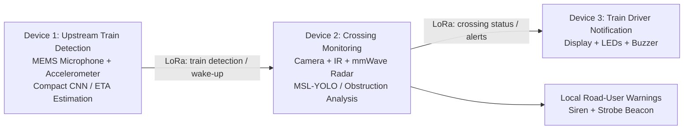

# Decentralized Edge-Interlocking: A Hybrid Acoustic-Vision Neural Pipeline for Predictive Train Detection and Trapped-Vehicle Avoidance at Unprotected Crossings

**Group 42 | Final-Year Software Engineering Project**

This project proposes a low-cost, decentralized railway-crossing monitoring and warning prototype for unprotected railway level crossings in Sri Lanka. It combines acoustic and vibration-based train detection, AI-assisted train arrival-time estimation, camera/radar-based obstruction monitoring, and LoRa communication to provide alerts to road users and train drivers.

> **Project status:** This README describes the system proposed in Group 42's Progress Report 01. It does not imply that every component has already been implemented or validated.

## Table of Contents

- [Problem Overview](#problem-overview)
- [Project Objectives](#project-objectives)
- [Proposed System Architecture](#proposed-system-architecture)
- [Device Responsibilities](#device-responsibilities)
- [Technology and Hardware](#technology-and-hardware)
- [System Workflow](#system-workflow)
- [AI and Detection Pipeline](#ai-and-detection-pipeline)
- [Evaluation Metrics](#evaluation-metrics)
- [Power and Communication](#power-and-communication)
- [Project Scope and Safety Disclaimer](#project-scope-and-safety-disclaimer)
- [Repository Structure](#repository-structure)
- [Team](#team)
- [Project Documentation](#project-documentation)

## Problem Overview

Unprotected railway crossings can expose road users and train passengers to serious risks. Drivers may not notice an approaching train in time, and vehicles or other objects may become trapped or remain on the railway track.

Conventional railway protection systems can require substantial trackside infrastructure, wiring, specialist equipment, and continuous electrical power. These requirements can make deployment difficult at remote or rural crossings.

The project investigates a decentralized alternative in which three local devices cooperate without depending on continuous internet connectivity or a centralized cloud service.

## Project Objectives

The proposed system aims to:

1. Detect approaching trains using acoustic and structural vibration signals.
2. Estimate the remaining time before an approaching train reaches the crossing.
3. Transmit train detection information wirelessly to the crossing-monitoring unit.
4. Detect vehicles and other objects within a defined railway crossing danger zone.
5. Distinguish persistent obstructions from vehicles that are simply passing through.
6. Notify the train driver about train and crossing conditions.
7. Activate local warning lights and a siren when an approaching train or obstruction requires attention.
8. Evaluate detection performance, communication reliability, response time, and power consumption.

## Proposed System Architecture

The architecture consists of three decentralized devices connected through point-to-point LoRa communication.



### Device 1 — Upstream Train Detection

Positioned upstream along the railway corridor, this unit collects acoustic and structural vibration signals associated with approaching trains.

Its proposed responsibilities are:

- Capture railway-environment audio using a MEMS microphone.
- Measure track-related vibration using an accelerometer.
- Process sensor data locally using an INT8-quantized compact CNN (CustomNet).
- Detect train-related signatures and estimate the train's arrival time at the crossing.
- Send a LoRa wake-up/detection packet to Device 2.

### Device 2 — Crossing Monitoring and Local Warning

This unit monitors the railway crossing danger zone. In the proposed workflow, it can remain in a low-power sleep state until it receives a train-detection message from Device 1.

Its proposed responsibilities are:

- Wake the monitoring components when a train is detected.
- Capture crossing images using an ESP32-S3-CAM with an OV2640 camera.
- Use an 850 nm infrared illuminator to support low-light monitoring.
- Use mmWave radar as an additional sensing method when visual conditions are poor.
- Run an INT8-quantized MSL-YOLO vision pipeline to identify vehicles and other objects.
- Apply a stationary dwell-time threshold to help distinguish persistent obstructions from transient crossing traffic.
- Activate local warning equipment when an obstruction is confirmed.
- Send crossing status to Device 3 through LoRa.

The proposed local warning equipment includes a relay-controlled 110 dB siren and a strobe beacon.

### Device 3 — Train Driver Notification

Located inside the train driver's cabin, this unit receives crossing-status information from Device 2.

Its proposed responsibilities are:

- Receive and parse LoRa messages.
- Display the crossing status and estimated train arrival information.
- Use LED indicators to communicate status:
  - Solid green: normal/clear status.
  - Flashing red: warning or obstruction status.
- Activate a buzzer when an alert is received.
- Apply a 4.0-second packet-timeout fallback to alert the driver if communication is lost.

The exact interpretation of each status and the timeout behaviour should follow the final system requirements and implementation.

## Technology and Hardware

The following technologies and components are identified in the progress report.

| Area | Proposed technology / component | Purpose |
|---|---|---|
| Train audio sensing | MEMS microphone (INMP441) | Capture train-related acoustic signals |
| Train vibration sensing | MPU6050 accelerometer | Capture structural vibration |
| Train detection AI | INT8-quantized compact CNN (CustomNet) | Identify train signatures from sensor data |
| Crossing camera | ESP32-S3-CAM with OV2640 | Capture the crossing danger zone |
| Low-light support | 850 nm IR illuminator | Assist camera monitoring in low light |
| Additional obstacle sensing | mmWave radar | Provide an additional sensing channel |
| Vision AI | INT8-quantized MSL-YOLO | Detect vehicles and other objects |
| Device communication | LoRa, point-to-point | Exchange detection and crossing-status messages |
| Local warnings | Relay, siren, strobe beacon | Warn road users near the crossing |
| Driver interface | Display, LEDs, buzzer | Present warnings to the train driver |
| Power | Solar panel, charge controller, rechargeable battery | Support off-grid operation |

Component selection, pin assignments, model versions, firmware frameworks, and final hardware specifications should be documented alongside the relevant implementation as the repository develops.

## System Workflow

1. **Continuous train monitoring:** Device 1 samples acoustic and vibration signals near the railway line.
2. **Train detection:** The compact CNN analyses the sensor information to identify train-related patterns.
3. **Arrival-time estimation:** Device 1 estimates the remaining time before the train reaches the crossing.
4. **Wake-up message:** Device 1 sends a LoRa packet to Device 2.
5. **Crossing inspection:** Device 2 activates its camera, IR illuminator, and radar monitoring components.
6. **Object detection:** The vision model identifies vehicles and other objects in the monitored area.
7. **Obstruction assessment:** A dwell-time check helps determine whether a detected object remains in the danger zone instead of merely passing through.
8. **Local warning:** If an obstruction is confirmed, Device 2 activates the siren and strobe beacon.
9. **Driver notification:** Device 2 sends the crossing status to Device 3, which updates its display and indicators and activates the buzzer when required.
10. **Communication fallback:** Device 3 uses the specified 4.0-second packet-timeout behaviour to raise an alert if expected communication is lost.

## AI and Detection Pipeline

### Acoustic and Vibration-Based Train Detection

The train-detection unit combines two sensor modalities:

- **Acoustic input:** Captures sounds generated by train movement.
- **Vibration input:** Captures mechanical vibrations associated with train movement along the railway infrastructure.

The progress report proposes an INT8-quantized compact CNN named **CustomNet** for local train-signature detection and arrival-time estimation. Quantization is intended to make inference more suitable for resource-constrained edge hardware.

### Vision-Based Obstruction Detection

The crossing-monitoring unit uses camera input to detect vehicles and other objects in the danger zone. The proposed vision model is an INT8-quantized **MSL-YOLO** pipeline.

Object detection alone does not establish that a vehicle is trapped. The proposed system therefore also considers how long an object remains stationary within the defined danger zone. Radar provides an additional sensing channel, particularly when camera visibility is reduced.

### Edge Processing

Detection and decision-making are intended to take place locally on the respective devices. The architecture is designed to reduce dependence on cloud processing, continuous internet access, and unnecessary transmission of raw sensor data.

## Evaluation Metrics

The prototype is intended to be evaluated as an integrated system, not only as a collection of individual models.

| Metric | What it evaluates |
|---|---|
| Train detection accuracy | Correct identification of approaching trains |
| Vehicle and obstacle detection accuracy | Correct identification of objects in the crossing danger zone |
| False-positive rate | How often the system reports an event that did not occur |
| False-negative rate | How often the system misses an event |
| Arrival-time estimation error | Difference between predicted and observed train arrival time |
| LoRa packet delivery success | Reliability of message delivery between devices |
| Communication latency | Time taken to transmit information |
| End-to-end response time | Time from initial detection to warning/driver notification |
| Power consumption | Energy use during sleep, sensing, processing, communication, and warning states |

Testing should consider varying environmental conditions, including background noise, low lighting, rain, and reduced visibility. Power testing should also consider the ability of the devices to operate using the proposed solar and rechargeable-battery arrangement.

## Power and Communication

- **Communication:** The proposed devices use LoRa point-to-point communication. The system is not designed to depend on a continuous internet connection for its core local monitoring and notification workflow.
- **Power:** The proposed off-grid arrangement includes solar panels, charge controllers, and rechargeable battery banks.
- **Edge operation:** Each device performs its assigned processing locally to reduce dependence on centralized computing.

Actual communication range, packet delivery rate, latency, and operating duration must be established through testing. They should not be assumed from the technology selection alone.

## Project Scope and Safety Disclaimer

This project is an experimental monitoring and notification prototype for unprotected railway crossings, with a focus on the Sri Lankan context.

It is intended to provide additional situational awareness to road users and train drivers. **It is not a certified railway signalling or safety-interlocking system.** It does not replace certified fail-safe railway signalling, automatic train braking, existing railway protection systems, or the judgement and procedures of railway operators. It does not guarantee collision prevention and must not be used as the sole safety mechanism for operating a railway.

## Repository Structure

The repository structure will depend on the implementation. A possible organization for the project is:

```text
.
├── device-1-train-detection/
│   ├── firmware/
│   ├── models/
│   └── data/
├── device-2-crossing-monitor/
│   ├── firmware/
│   ├── vision-model/
│   └── data/
├── device-3-driver-notification/
│   └── firmware/
├── communication/
│   └── protocol/
├── hardware/
│   ├── schematics/
│   └── documentation/
├── docs/
│   ├── progress-report/
│   ├── requirements/
│   └── design/
└── README.md
```

This is a suggested layout, not a statement of the repository's current contents. Update it to match the actual folders and files committed to GitHub.

## Team

**Group 42**

| Member | Name |
|---|---|
| L.B.D.M.A. Wijesundara | Project team member |
| W.K.K.Y. Madhuhansa | Project team member |
| K.P.D. Abhilashi | Project team member |
| A.A. Weerasuriya | Project team member |
| M.R. Rasiyya | Project team member |

## Project Documentation

The project progress report identifies the following supporting documents:

- **Progress Report 01** — project background, objectives, literature survey, proposed architecture, evaluation approach, and conclusion.
- **Software Requirements Specification (SRS)** — functional, non-functional, interface, technical, security, and performance requirements.
- **Project Plan** — project organization, responsibilities, configuration and change management, milestones, risks, and quality assurance.
- **CMMI Meeting Minutes** — records of team discussions, progress, and planned actions.

Add the SRS, project plan, meeting minutes, architecture diagrams, and other approved documents to the repository's `docs/` directory when they are ready to be shared.

---

*Prepared from Group 42 — Progress Report 01. Implementation details should be updated as the prototype evolves.*
