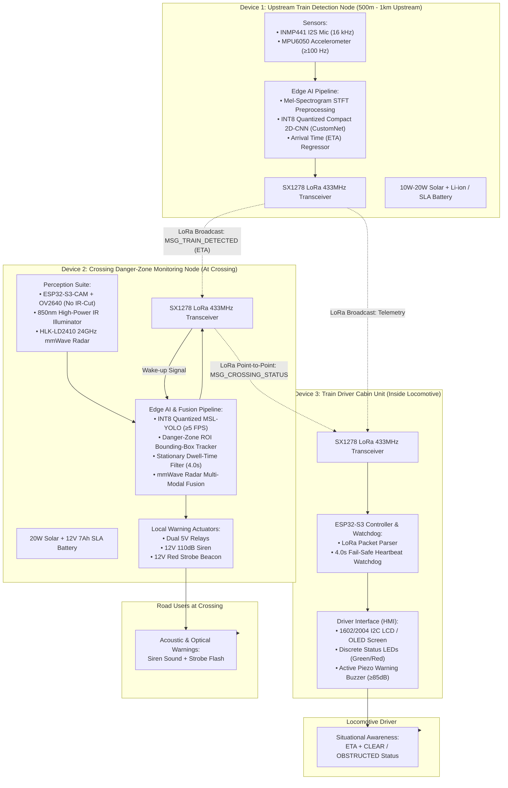
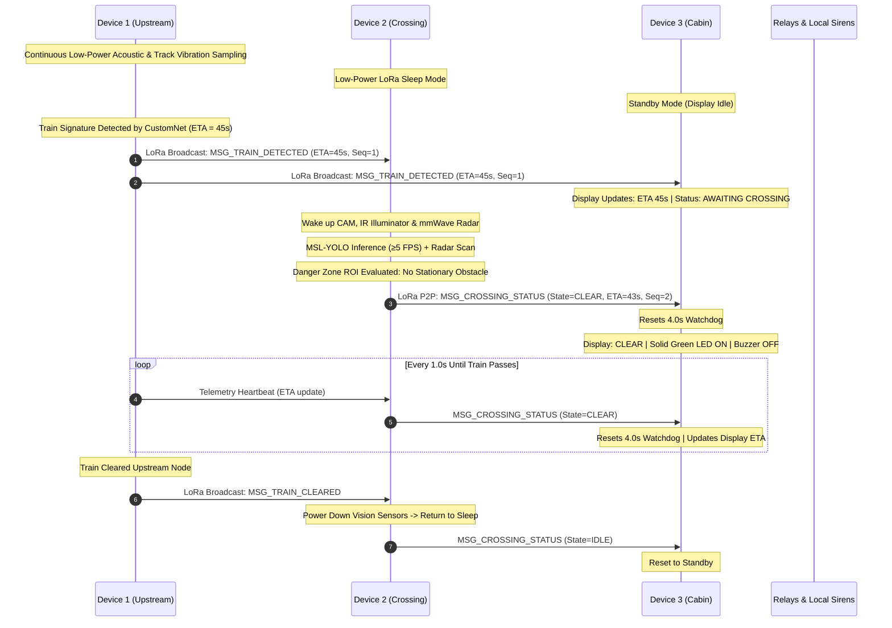
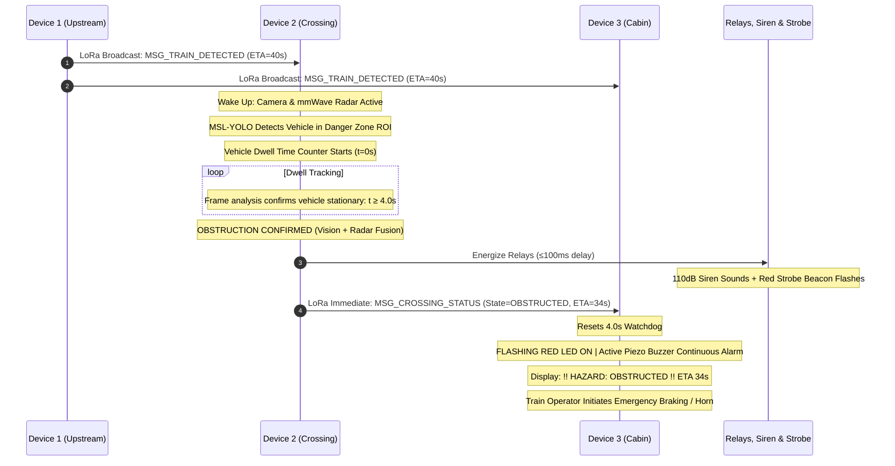
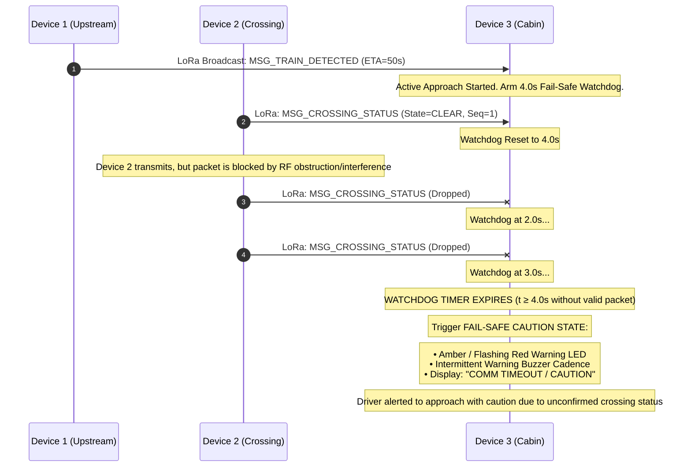
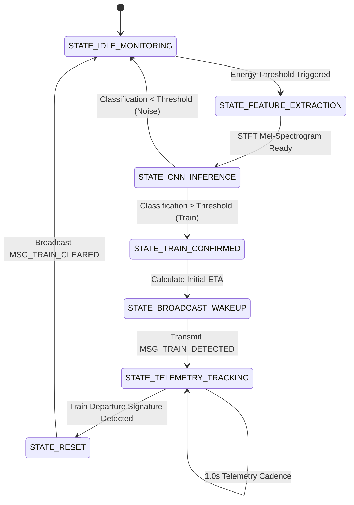
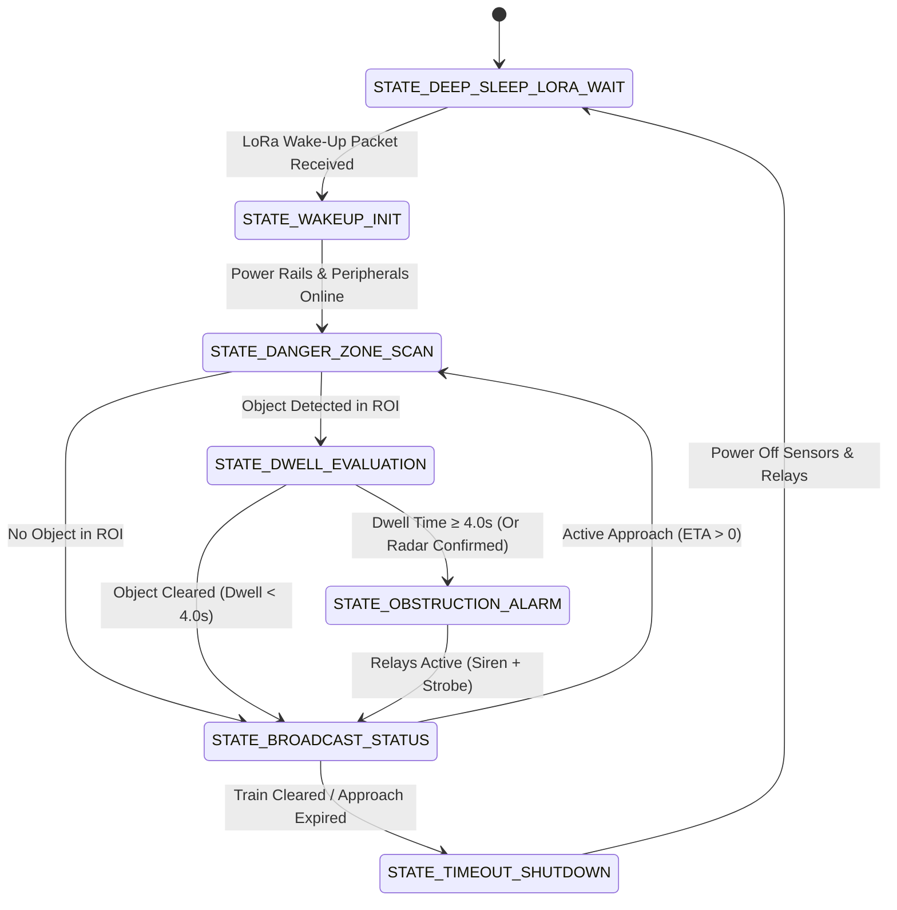
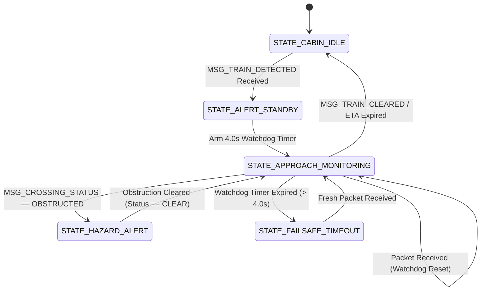

# System Architecture: Decentralized Edge-Interlocking Railway Crossing Safety System

**Project:** Final-Year Software Engineering Prototype (Group 42)  
**Target Environment:** Unprotected rural railway level crossings in Sri Lanka  
**Design Paradigm:** Fully decentralized, edge-native AI, off-grid solar/battery operation, wireless LoRa ad-hoc telemetry (zero cloud/cellular reliance, zero trackside cabling)

---

## 1. System Overview

The **Decentralized Edge-Interlocking System** addresses catastrophic collisions at unprotected railway level crossings through a distributed 3-node edge architecture. Rural level crossings often lack electrical grid connections and cellular data coverage, rendering cloud-dependent or wired track-circuit safety solutions impractical.

This system replaces centralized interlocking with an autonomous, multi-sensor, multi-node edge computing pipeline running local INT8-quantized neural networks on Espressif ESP32-S3 microcontrollers, communicating via point-to-point Semtech SX1278 LoRa transceivers at 433 MHz.

---

## 2. Node Responsibilities & Internal Pipelines

### 2.1 Device 1: Upstream Train Detection Node (`device-1-upstream`)
* **Physical Placement:** Mounted rigidly on the railway track rail web/sleeper approximately 500 m to 1,000 m ahead of the level crossing.
* **Sensing Modalities:**
  * **Acoustics:** INMP441 omnidirectional MEMS microphone operating over I2S digital audio at 16 kHz sampling rate (captures wheel-rail screech, engine roar, horn).
  * **Vibrations:** MPU6050 6-axis IMU accelerometer sampled via I2C at $\ge 100\text{ Hz}$ (captures structural P-waves and surface rail acoustic emissions).
* **Edge Inference (CustomNet):**
  * Time-domain signals undergo fixed-point FFT/STFT windowing to produce logarithmic Mel-spectrograms.
  * An INT8-quantized compact 2D-CNN (**CustomNet**, ~1.63 MB footprint) executes inference within $\le 1.2\text{ s}$ to classify train acoustic signatures vs. environmental noise (heavy road traffic, wind, thunderstorms).
  * Feature growth dynamics estimate the Train Arrival Time (**ETA**).
* **Communication:** Assembles and transmits a binary LoRa packet (`MSG_TRAIN_DETECTED`, `ETA`, `Battery Voltage`) at 433 MHz. Continues transmitting 1.0 Hz periodic updates while the train approaches.

### 2.2 Device 2: Crossing Danger-Zone Monitoring Node (`device-2-crossing`)
* **Physical Placement:** Stationed roadside at the level crossing on a rigid mast with a direct field of view over the railway-road intersection danger zone.
* **Power Management:** Remains in low-power LoRa listening sleep mode until an incoming wake-up packet from Device 1 is received, avoiding continuous battery drain.
* **Perception Modalities:**
  * **Vision:** ESP32-S3-CAM with OV2640 sensor (IR-cut filter removed) paired with an 850 nm high-power infrared illuminator for zero-lux night vision.
  * **mmWave Radar:** HLK-LD2410 24 GHz FMCW radar communicating over UART at 3.3V logic. Provides range, speed, and energy detection immune to dense fog, monsoon downpours, smoke, or optical glare.
* **Edge Vision & Fusion Pipeline:**
  * **MSL-YOLO Inference:** Runs an INT8-quantized MSL-YOLO object detection model processing frames at $\ge 5\text{ FPS}$ to identify vehicles, motorcycles, tuk-tuks, carts, and pedestrians within a calibrated danger-zone Region of Interest (ROI).
  * **Stationary Dwell-Time Filter:** A temporal bounding-box tracker measures dwell time. Transient objects traversing the crossing normally (dwell $< 4.0\text{ s}$) are ignored. If an object remains stationary in the danger zone for $\ge 4.0\text{ s}$ (stalled vehicle, trapped cart), an obstruction event is confirmed.
  * **Radar Cross-Validation:** Fuses vision bounding boxes with radar range bins. If vision is occluded by mud or extreme weather, radar target presence confirms the obstacle.
* **Actuation:**
  * Energizes local 5V optocoupled relays to fire a 12V 110 dB siren and red flashing strobe beacon to warn crossing road users.
  * Dispatches `MSG_CROSSING_STATUS` (`CLEAR` vs. `OBSTRUCTED`) via LoRa to Device 3.

### 2.3 Device 3: Train Driver Cabin Unit (`device-3-cabin`)
* **Physical Placement:** Installed in the locomotive operator cab, powered by cabin auxiliary power with internal battery backup.
* **HMI Indicators:**
  * **Visual Screen:** 1602/2004 character I2C LCD (or 1.3" I2C OLED display) showing real-time text: approaching train status, remaining ETA countdown, and crossing state.
  * **Discrete Status LEDs:** Solid Green = Crossing Clear; Flashing Red = Crossing Obstructed / Hazard.
  * **Acoustic Warning:** High-output 5V piezo buzzer emitting continuous or pulsed warning tones.
* **Fail-Safe Watchdog (4.0s Packet Timeout):**
  * During an active train approach, Device 3 expects periodic telemetry packets every 1.0 s.
  * If no packet is received for $> 4.0\text{ s}$, Device 3 triggers a **Fail-Safe Caution Alert** (pulsing buzzer, warning indicator, LCD communication lost warning) instructing the driver to prepare for potential stop/caution.

---

## 3. End-to-End Operational Sequences

### 3.1 Nominal Sequence: Clear Crossing

### 3.2 Hazard Sequence: Trapped Vehicle in Danger Zone

### 3.3 Fail-Safe Sequence: LoRa Packet Loss / RF Interference

---

## 4. Node Finite State Machines (FSM)

### 4.1 Device 1 State Machine

* **`STATE_IDLE_MONITORING`:** Low-power continuous I2S and I2C circular buffer sampling. Low CPU clock.
* **`STATE_FEATURE_EXTRACTION`:** Dynamic signal energy triggers sliding-window STFT and Mel-frequency filterbank computation.
* **`STATE_CNN_INFERENCE`:** INT8 quantized CustomNet 2D-CNN evaluates spatial-spectral features ($\le 1.2\text{ s}$).
* **`STATE_TRAIN_CONFIRMED`:** Speed and distance curves yield integer ETA value (in seconds).
* **`STATE_BROADCAST_WAKEUP`:** Transmits LoRa wake-up broadcast packet to Devices 2 and 3.
* **`STATE_TELEMETRY_TRACKING`:** Periodically emits updated telemetry packets every 1.0 s.
* **`STATE_RESET`:** Confirms train exit, emits reset packet, returns to idle.

### 4.2 Device 2 State Machine

* **`STATE_DEEP_SLEEP_LORA_WAIT`:** SX1278 in CAD/RX mode, ESP32-S3 in light sleep, camera and illuminator unpowered.
* **`STATE_WAKEUP_INIT`:** High-side switches energize camera, 850nm IR illuminator, and HLK-LD2410 radar within $< 150\text{ ms}$.
* **`STATE_DANGER_ZONE_SCAN`:** MSL-YOLO vision model runs at $\ge 5\text{ FPS}$ on $320 \times 240$ frame stream.
* **`STATE_DWELL_EVALUATION`:** Tracks coordinates of vehicles/obstacles inside danger zone boundary; tracks dwell counter.
* **`STATE_OBSTRUCTION_ALARM`:** Fires dual relays to drive 110 dB siren and strobe beacon ($\le 100\text{ ms}$ post-verification).
* **`STATE_BROADCAST_STATUS`:** Emits `MSG_CROSSING_STATUS` to Device 3.
* **`STATE_TIMEOUT_SHUTDOWN`:** Train departure message or safety timeout shuts down high-draw peripherals and restores sleep.

### 4.3 Device 3 State Machine

* **`STATE_CABIN_IDLE`:** Display shows standby status; solid low-power indicators; listening on LoRa.
* **`STATE_ALERT_STANDBY`:** Train detection registered; display shows initial ETA; arms 4.0s packet watchdog.
* **`STATE_APPROACH_MONITORING`:** Periodic packets reset the 4.0s watchdog timer; green LED remains active if crossing clear.
* **`STATE_HAZARD_ALERT`:** Crossing obstructed; flashing red LED; continuous piezo buzzer alarm; LCD warning.
* **`STATE_FAILSAFE_TIMEOUT`:** Missing telemetry during active train approach; buzzer caution pulses; amber warning.

---

## 5. Non-Functional & Performance SLAs

Derived directly from the System Requirements Specification (SRS Table 2) and field validation criteria:

| Parameter | Operational Threshold | Design Target | Failure Condition |
|---|---|---|---|
| **Upstream Detection to Alert Signal** | $\le 1.5\text{ s}$ | $1.0\text{ s}$ | $> 2.0\text{ s}$ latency |
| **LoRa Packet Airtime (SF7, 125 kHz)** | $\le 120\text{ ms}$ | $85\text{ ms}$ | $> 150\text{ ms}$ airtime |
| **Relay Trigger Delay Post-Dwell** | $\le 100\text{ ms}$ | $50\text{ ms}$ | $> 200\text{ ms}$ |
| **In-Cabin Display Refresh Rate** | $\ge 2\text{ Hz}$ | $5\text{ Hz}$ | $< 1\text{ Hz}$ |
| **Vision Inference Rate (MSL-YOLO)** | $\ge 5\text{ FPS}$ | $8\text{ FPS}$ | $< 3\text{ FPS}$ |
| **Stationary Dwell-Time Filter** | $4.0\text{ s} \pm 0.2\text{ s}$ | $4.0\text{ s}$ | False trigger on passing cars ($<2.5\text{ s}$) |
| **Packet Reception Rate (PRR)** | $\ge 95\%$ @ 500m LoS | $\ge 98\%$ @ 500m LoS | $< 90\%$ PRR |
| **Fail-Safe Watchdog Timeout** | $4.0\text{ s} \pm 0.1\text{ s}$ | $4.0\text{ s}$ | Undetected link drop ($> 4.5\text{ s}$) |
| **Off-Grid Autonomy Buffer** | $\ge 24\text{ hours}$ | $48\text{ hours}$ | Brownout during overcast weather |

---

## 6. Safety & Integrity Architecture

1. **Fail-Safe Default Philosophy:** In railway engineering, the absence of confirmed safety must default to the presence of danger. If communication drops during a confirmed train approach, Device 3 automatically triggers a fail-safe caution alert.
2. **Multi-Modal Redundancy:** Device 2 does not rely solely on optical computer vision. When optical degradation occurs (monsoon rain, dust, lens mud, complete darkness), the 24 GHz mmWave radar provides redundant spatial presence detection.
3. **Execution Integrity:** Firmware tasks are governed by hardware Task Watchdog Timers (WDT) set to 2.0 seconds to prevent software freezes or deadlock from halting safety-critical loops.
4. **Local Autonomy:** Each node possesses full authority to execute its primary safety action locally (e.g. Device 2 triggers siren/strobe relays directly without needing a cloud handshake or remote authorization).
