# LoRa Wireless Communication Protocol & Fail-Safe Specification

**Project:** Decentralized Edge-Interlocking Railway Crossing Safety System (Group 42)  
**Standard:** Custom Ad-Hoc Binary Point-to-Point Protocol  
**Transceiver:** Semtech SX1278 (SPI Interface)  
**Frequency Band:** 433 MHz ISM Band

---

## 1. Physical Layer (PHY) RF Configuration

The 3-node decentralized system communicates directly over peer-to-peer LoRa. The RF modem configuration balances packet airtime, receiver sensitivity, and propagation resilience across a 500 m to 1,500 m rural line-of-sight (LoS) rail corridor.

| Parameter | Configured Value | Engineering Rationale |
|---|---|---|
| **Carrier Frequency** | `433.175 MHz` | Unlicensed regional ISM band in Sri Lanka with superior foliage penetration and diffraction around rail cuttings |
| **Bandwidth (BW)** | `125 kHz` | Standard LoRa bandwidth offering balanced SNR and acceptable noise floor |
| **Spreading Factor (SF)** | `SF7` (128 chips/symbol) | Minimizes airtime ($\le 85\text{ ms}$) while maintaining link margin ($\ge 148\text{ dB}$) |
| **Coding Rate (CR)** | `4/5` (1 error check bit / 4 data bits) | Minimal forward error correction overhead with high packet throughput |
| **Preamble Length** | `8 symbols` | Ensures reliable preamble detection by SX1278 without excessive airtime |
| **Sync Word** | `0x12` | Private network isolation; prevents packet collisions with public LoRaWAN nodes |
| **Tx Output Power** | `+17 dBm` (Configurable up to `+20 dBm`) | Provides $\ge 15\text{ dB}$ link margin over 500 m LoS rail corridor |
| **Header Mode** | `Explicit Header` | Hardware length and CRC signaling enabled in physical layer |
| **CRC Mode** | `Enabled` | SX1278 hardware payload CRC generation and checking |

---

## 2. Binary Packet Structure (14-Byte Fixed Payload)

To minimize channel occupancy, eliminate parsing overhead on edge microcontrollers, and maintain airtime well beneath the $120\text{ ms}$ threshold (SRS Table 2), all inter-node communication utilizes a fixed-size **14-byte packed binary frame**.

### 2.1 Memory Map & Byte Offset Table

```text
 0      1      2      3      4      5      6      7      8      9     10     11     12     13
+------+------+------+------+------+------+------+------+------+------+------+------+------+------+
| MAGIC| VER  | SRC  | DEST | TYPE | SEQ  | STATE| FLAGS|  ETA (LSB/MSB)| BATT (LSB/MSB)| CRC16|
+------+------+------+------+------+------+------+------+------+------+------+------+------+------+
```

| Byte Offset | Field Name | Data Type | Permitted Values | Field Description |
|---|---|---|---|---|
| `0x00` | `magic_byte` | `uint8_t` | `0xAA` | Application preamble magic byte for rapid packet framing and noise rejection |
| `0x01` | `version` | `uint8_t` | `0x01` | Protocol revision version |
| `0x02` | `source_node_id` | `uint8_t` | `0x01`, `0x02`, `0x03` | Transmitting node ID (`0x01`=Dev1, `0x02`=Dev2, `0x03`=Dev3) |
| `0x03` | `dest_node_id` | `uint8_t` | `0x00`, `0x02`, `0x03` | Target recipient (`0x00`=Broadcast, `0x02`=Dev2, `0x03`=Dev3) |
| `0x04` | `msg_type` | `uint8_t` | `0x01` - `0x05` | Operational message category (see Section 2.2) |
| `0x05` | `seq_num` | `uint8_t` | `0` to `255` | Incrementing transaction counter; detects dropped/replayed packets |
| `0x06` | `crossing_state` | `uint8_t` | `0x00` - `0x03` | Real-time crossing condition indicator (see Section 2.3) |
| `0x07` | `status_flags` | `uint8_t` | Bitmask | Bitwise sensor, actuator, and operational diagnostics (see Section 2.4) |
| `0x08 - 0x09` | `eta_seconds` | `uint16_t` (LE) | `0` to `65534` | Estimated train arrival time in seconds (`0xFFFF` = Invalid/Unavailable) |
| `0x0A - 0x0B` | `battery_mv` | `uint16_t` (LE) | `2500` to `15000` | Node supply battery voltage in millivolts (e.g. `3750` = 3.75V, `12400` = 12.4V) |
| `0x0C - 0x0D` | `crc16` | `uint16_t` (LE) | `0x0000` - `0xFFFF` | Application-layer CRC-16-CCITT calculated over bytes `0x00` through `0x0B` |

---

### 2.2 Enumerated Values

#### Message Types (`msg_type`)
```c
typedef enum {
    MSG_TYPE_TRAIN_DETECTED = 0x01,  // Device 1 -> Broadcast / Device 2 & 3: Train approach alert
    MSG_TYPE_CROSSING_STATUS = 0x02, // Device 2 -> Device 3: Crossing danger-zone status
    MSG_TYPE_HEARTBEAT       = 0x03, // Periodic keepalive / battery diagnostic
    MSG_TYPE_ACK             = 0x04, // Unicast acknowledgment response
    MSG_TYPE_TRAIN_CLEARED   = 0x05  // Device 1/2 -> Reset: Train has completely passed crossing
} lora_msg_type_t;
```

#### Crossing States (`crossing_state`)
```c
typedef enum {
    CROSSING_STATE_IDLE_CLEAR     = 0x00, // No train approaching; crossing danger zone clear
    CROSSING_STATE_APPROACHING    = 0x01, // Train approaching; danger zone active, currently clear
    CROSSING_STATE_OBSTRUCTED     = 0x02, // Stationary obstacle / vehicle confirmed trapped
    CROSSING_STATE_FAULT_DEGRADED = 0x03  // Sensor or hardware fault (failsafe caution triggered)
} lora_crossing_state_t;
```

#### Node Identifiers (`source_node_id`, `dest_node_id`)
```c
typedef enum {
    NODE_ID_BROADCAST = 0x00,
    NODE_ID_DEVICE1   = 0x01, // Upstream Train Detector
    NODE_ID_DEVICE2   = 0x02, // Crossing Danger-Zone Monitor
    NODE_ID_DEVICE3   = 0x03  // In-Cabin Locomotive Unit
} lora_node_id_t;
```

---

### 2.3 Status Flags Bitmask (`status_flags`)

Byte `0x07` provides bitwise telemetry across all sensor subsystems:

| Bit | Identifier | Meaning When Set (`1`) | Meaning When Clear (`0`) |
|---|---|---|---|
| `Bit 0` | `FLAG_VISION_TARGET_DETECTED` | MSL-YOLO detected object in danger zone ROI | Vision ROI clear |
| `Bit 1` | `FLAG_RADAR_TARGET_DETECTED` | HLK-LD2410 mmWave radar detected presence | Radar target absent |
| `Bit 2` | `FLAG_RELAY_SIREN_ACTIVE` | 12V siren & strobe relays energised | Relays de-energised |
| `Bit 3` | `FLAG_IR_ILLUMINATOR_ON` | 850nm IR illuminator activated (night mode) | IR illuminator off |
| `Bit 4` | `FLAG_CAM_OCCLUDED_FAULT` | Camera stream degraded / zero FPS / lens occluded | Camera operational |
| `Bit 5` | `FLAG_RADAR_FAULT` | mmWave radar UART communication failure | Radar operational |
| `Bit 6` | `FLAG_BATTERY_LOW` | Battery voltage below critical threshold ($<3.2\text{V}$ / $<11.0\text{V}$) | Battery nominal |
| `Bit 7` | `FLAG_FAILSAFE_ACTIVE` | Node operating under degraded/fail-safe fallback | Normal operation |

---

### 2.4 C/C++ Header Definition (`shared_protocol`)

```c
#ifndef RAIL_LORA_PROTOCOL_H
#define RAIL_LORA_PROTOCOL_H

#include <stdint.h>

#define LORA_MAGIC_BYTE       0xAA
#define LORA_PROTOCOL_VERSION 0x01
#define LORA_PACKET_SIZE      14

#pragma pack(push, 1)
typedef struct {
    uint8_t  magic_byte;      // Fixed 0xAA
    uint8_t  version;         // Protocol version (0x01)
    uint8_t  source_node;     // Node ID of sender (0x01, 0x02, 0x03)
    uint8_t  dest_node;       // Target Node ID (0x00=Broadcast, 0x02, 0x03)
    uint8_t  msg_type;        // Message type
    uint8_t  seq_num;         // Incrementing sequence counter
    uint8_t  crossing_state;  // Crossing status enum
    uint8_t  status_flags;    // Telemetry bitmask
    uint16_t eta_seconds;     // ETA in seconds (0xFFFF = invalid)
    uint16_t battery_mv;      // Battery voltage in millivolts
    uint16_t crc16;           // CRC-16-CCITT (Bytes 0..11)
} rail_lora_packet_t;
#pragma pack(pop)

#endif // RAIL_LORA_PROTOCOL_H
```

---

## 3. Physical Airtime Calculation & Mathematical Verification

Under Semtech SX1278 LoRa PHY formulas:

1. **Symbol Duration ($T_s$):**
   $$T_s = \frac{2^{SF}}{BW} = \frac{2^7}{125000\text{ Hz}} = \frac{128}{125000} = 1.024\text{ ms}$$

2. **Preamble Duration ($T_{preamble}$):**
   $$T_{preamble} = (N_{preamble} + 4.25) \times T_s = (8 + 4.25) \times 1.024\text{ ms} = 12.544\text{ ms}$$

3. **Payload Symbol Count ($N_{payload}$):**
   Given $PL = 14\text{ bytes}$, $SF = 7$, $CR = 1$ ($4/5$), $CRC = 1$ (enabled), $IH = 0$ (explicit header), $DE = 0$ (low data rate optimize off):
   $$N_{payload} = 8 + \max\left(\left\lceil \frac{8PL - 4SF + 28 + 16CRC - 20IH}{4(SF - 2DE)} \right\rceil \times (CR + 4),\; 0\right)$$
   $$N_{payload} = 8 + \max\left(\left\lceil \frac{8(14) - 4(7) + 28 + 16(1) - 0}{4(7 - 0)} \right\rceil \times (1 + 4),\; 0\right)$$
   $$N_{payload} = 8 + \max\left(\left\lceil \frac{112 - 28 + 28 + 16}{28} \right\rceil \times 5,\; 0\right) = 8 + \left(\left\lceil \frac{128}{28} \right\rceil \times 5\right) = 8 + (5 \times 5) = 33\text{ symbols}$$

4. **Total Time-on-Air ($T_{ToA}$):**
   $$T_{payload} = N_{payload} \times T_s = 33 \times 1.024\text{ ms} = 33.792\text{ ms}$$
   $$T_{ToA} = T_{preamble} + T_{payload} = 12.544\text{ ms} + 33.792\text{ ms} = 46.336\text{ ms}$$

**Conclusion:** The total on-air duration of a 14-byte packet is **$46.34\text{ ms}$**. This easily outperforms both the **$120\text{ ms}$ operational threshold** and the **$85\text{ ms}$ engineering design target** specified in SRS Table 2.

---

## 4. The 4.0-Second Fail-Safe Timeout Rule

### 4.1 Specification & Rationale
In railway safety interlocking, loss of telemetry during an active train approach is a critical hazard: the train is moving toward the crossing at track speed, but the status of vehicles in the danger zone is unknown.

* **Transmission Cadence:** During an active approach, Device 1 and Device 2 emit status packets at **$1.0\text{ Hz}$ intervals** ($1000\text{ ms} \pm 50\text{ ms}$).
* **Watchdog Timeout Window:** Device 3 runs a strict hardware/software timer set to **$4000\text{ ms}$ ($4.0\text{ s}$)**.
* **Tolerable Packet Loss:** A 4.0 s window permits up to 3 consecutively dropped packets (at 1.0s, 2.0s, 3.0s) due to transient RF fading before declaring link failure, preventing false alarms while ensuring rapid response.

```mermaid
gantt
    title Device 3 In-Cabin 4.0s Fail-Safe Heartbeat Watchdog
    dateFormat X
    axisFormat %s s
    section Packet Stream
    Pkt 1 (t=0s, Reset WD)       :done, p1, 0, 1
    Pkt 2 (t=1s, Reset WD)       :done, p2, 1, 2
    Pkt 3 Dropped (t=2s)         :crit, p3, 2, 3
    Pkt 4 Dropped (t=3s)         :crit, p4, 3, 4
    Pkt 5 Dropped (t=4s)         :crit, p5, 4, 5
    section Fail-Safe Watchdog
    Watchdog Armed (4.0s timer)  :active, wd1, 0, 4
    FAIL-SAFE TRIGGERED (t=4.0s) :milestone, m1, 4, 4
    Fail-Safe Caution Alert Active:crit, fs, 4, 7
```



### 4.2 Fail-Safe State Transition & Driver Alerts
When the watchdog timer elapses without a valid CRC-verified packet from Device 2:
1. **FSM State Transition:** Device 3 transitions from `STATE_APPROACH_MONITORING` to `STATE_FAILSAFE_TIMEOUT`.
2. **Visual Alert:**
   * Discrete status LEDs switch to **Flashing Amber / Rapid Flashing Red**.
   * Display unit (LCD/OLED) updates immediately:
     ```text
     [WARN] COMM TIMEOUT
     CROSSING UNKNOWN
     APPROACH CAUTION!
     ```
3. **Acoustic Alert:** Piezo buzzer activates an **intermittent warning cadence** (200 ms ON / 200 ms OFF) to alert the locomotive driver to initiate safety braking procedures and sound the locomotive horn.
4. **Recovery Protocol:** If a fresh, CRC-verified packet is subsequently received before the train passes:
   * The watchdog resets to $4.0\text{ s}$.
   * Display and LEDs restore to real-time status (`CLEAR` or `OBSTRUCTED`).
   * Buzzer pattern aligns with current crossing condition.

---

## 5. Packet Integrity, Security & Anti-Replay

1. **Hardware & Software Checksums:**
   * Transmissions use the SX1278 hardware CRC to reject physical bit-errors at the radio layer.
   * Firmware computes a **CRC-16-CCITT** polynomial (`0x1021`, init `0xFFFF`) over bytes `0` to `11`. Packets with mismatching CRC bytes `12..13` are discarded before state evaluation.
2. **Network ID Isolation:** `magic_byte = 0xAA` combined with private sync word `0x12` isolates the safety system from third-party LoRa transmitters.
3. **Anti-Replay Counter (`seq_num`):** Each node increments `seq_num` on every transmission. Device 3 tracks the last received sequence number; duplicate or retrograde packet IDs are logged and ignored.
